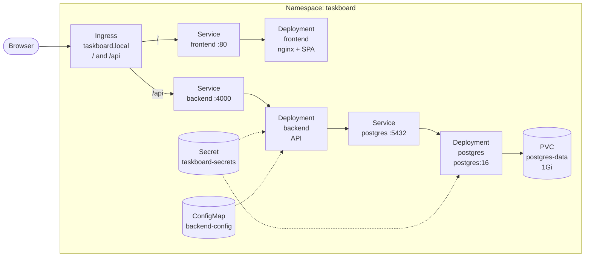

# TaskBoard Kubernetes

Manifests for deploying TaskBoard (Postgres, API, frontend, Ingress) into a `taskboard` namespace.

Related repos: [taskboard-api](https://github.com/FinnTheHero/taskboard-api) · [taskboard-front](https://github.com/FinnTheHero/taskboard-front)

> Build the app images from sibling clone directories (`../taskboard-api`, `../taskboard-front`) or adjust the paths below.

## Architecture



**Request flow:** Browser → Ingress → frontend (`/`) or backend (`/api`) → Postgres.

| File | Kind | Purpose |
|------|------|---------|
| `00-namespace.yaml` | Namespace | Isolates resources in `taskboard` |
| `01-secrets.yaml` | Secret | DB credentials, `DATABASE_URL`, `JWT_SECRET` |
| `02-configmap.yaml` | ConfigMap | Non-secret backend config |
| `03-postgres-pvc.yaml` | PersistentVolumeClaim | 1Gi disk for Postgres data |
| `04-postgres-deployment.yaml` | Deployment | Postgres pod with probes + volume |
| `05-postgres-service.yaml` | Service | Cluster DNS `postgres:5432` |
| `06-backend-deployment.yaml` | Deployment | API; init container waits for DB |
| `07-backend-service.yaml` | Service | Exposes API on port 4000 |
| `08-frontend-deployment.yaml` | Deployment | nginx serving the React SPA |
| `09-frontend-service.yaml` | Service | Exposes frontend on port 80 |
| `10-ingress.yaml` | Ingress | Routes external HTTP to services |

## Prerequisites

- `kubectl` configured for your cluster
- Docker (for building images)

## OrbStack (local)

1. Enable Kubernetes in OrbStack and verify:

   ```bash
   kubectl cluster-info
   ```

2. Build images (OrbStack shares the Docker daemon with Kubernetes):

   ```bash
   docker build -t taskboard-api:local ../taskboard-api
   docker build -t taskboard-front:local --build-arg VITE_API_URL=/api ../taskboard-front
   ```

3. Copy secrets if needed (dev values are already in `01-secrets.yaml`):

   ```bash
   cp secrets.example.yaml 01-secrets.yaml
   # edit passwords and JWT_SECRET
   ```

4. Apply manifests:

   ```bash
   kubectl apply -f .
   ```

5. Watch rollout:

   ```bash
   kubectl get pods -n taskboard -w
   ```

6. Open via Ingress IP (`kubectl get ingress -n taskboard`) or add `127.0.0.1 taskboard.local` to `/etc/hosts`.

### Debug

```bash
kubectl get all -n taskboard
kubectl describe pod -n taskboard -l app=backend
kubectl logs -f deployment/backend -n taskboard
kubectl logs -f deployment/postgres -n taskboard
kubectl get ingress -n taskboard
```

## Any Kubernetes cluster

Same manifests work on a standard Kubernetes cluster (kind, minikube, cloud, etc.). Differences from local OrbStack:

1. **Images** — nodes cannot see images you only built on your laptop. Push to a registry, then point the Deployments at those tags:

   ```bash
   docker build -t ghcr.io/<your-user>/taskboard-api:latest ../taskboard-api
   docker build -t ghcr.io/<your-user>/taskboard-front:latest --build-arg VITE_API_URL=/api ../taskboard-front
   docker push ghcr.io/<your-user>/taskboard-api:latest
   docker push ghcr.io/<your-user>/taskboard-front:latest
   ```

   In `06-backend-deployment.yaml` and `08-frontend-deployment.yaml`, set the image names above, `imagePullPolicy: Always`, and add `imagePullSecrets` if the registry is private.

2. **Ingress** — ensure an Ingress controller is installed (e.g. ingress-nginx). Update the host in `10-ingress.yaml` and `CORS_ORIGIN` in `02-configmap.yaml` to your real hostname or load-balancer URL.

3. **Storage** — the PVC uses the cluster default StorageClass. Check what is available:

   ```bash
   kubectl get sc
   ```

   If there is no default, set `spec.storageClassName` on `03-postgres-pvc.yaml` to a class that supports `ReadWriteOnce`.

## Secrets

| Key | Used by |
|-----|---------|
| `POSTGRES_USER` | Postgres |
| `POSTGRES_PASSWORD` | Postgres |
| `POSTGRES_DB` | Postgres |
| `DATABASE_URL` | Backend |
| `JWT_SECRET` | Backend (min 16 characters) |

- `secrets.example.yaml` — template with placeholders (safe to commit)
- `01-secrets.yaml` — local dev defaults; do not commit production secrets

## Common issues

| Symptom | Likely cause |
|---------|--------------|
| Backend exits immediately | Missing or wrong `DATABASE_URL` / `JWT_SECRET` |
| Frontend loads but API fails (405) | Hit frontend Service directly; use Ingress so `/api` reaches backend |
| Frontend calls wrong API | Rebuild after changing `VITE_API_URL` (build-time) |
| `ImagePullBackOff` | Image only exists locally; push to a registry (or load into the cluster) and update Deployment image names |
| Postgres empty after delete | PVC was deleted; data lives on the PVC |

## Tear down

```bash
kubectl delete -f .
kubectl delete pvc postgres-data -n taskboard   # also wipe DB data
```
