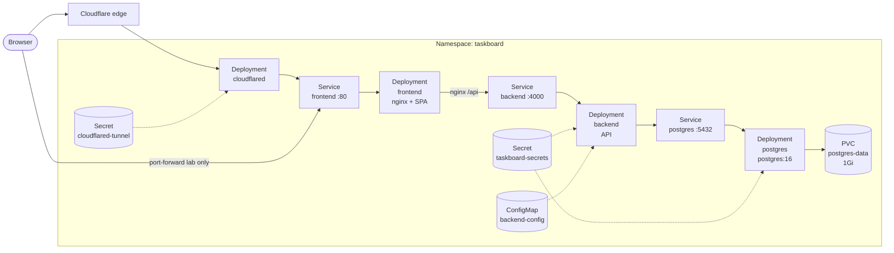

# TaskBoard Kubernetes

Manifests for deploying TaskBoard (Postgres, API, frontend, Ingress) into a `taskboard` namespace.

Related repos: [taskboard-api](https://github.com/FinnTheHero/taskboard-api) · [taskboard-front](https://github.com/FinnTheHero/taskboard-front)

App images are public on GHCR (no pull secret required):

- `ghcr.io/finnthehero/taskboard-api:latest`
- `ghcr.io/finnthehero/taskboard-front:latest`

Build and push for **`linux/amd64`** (typical cluster nodes). Images built on Apple Silicon without `--platform linux/amd64` will fail with `ImagePullBackOff` / `no match for platform in manifest`.

## Architecture



**Public access:** Cloudflare Tunnel → `frontend:80` (nginx serves the SPA and proxies `/api` to `backend:4000`). No Ingress controller required.

Services are **ClusterIP** — tunnel (or port-forward) is how you reach them from outside.

| File | Kind | Purpose |
|------|------|---------|
| `00-namespace.yaml` | Namespace | Isolates resources in `taskboard` |
| `01-secrets.yaml` | Secret | DB credentials, `DATABASE_URL`, `JWT_SECRET` |
| `02-configmap.yaml` | ConfigMap | Non-secret backend config (`CORS_ORIGIN`) |
| `03-postgres-pvc.yaml` | PersistentVolumeClaim | 1Gi disk for Postgres data |
| `04-postgres-deployment.yaml` | Deployment | Postgres pod with probes + volume |
| `05-postgres-service.yaml` | Service | Cluster DNS `postgres:5432` |
| `06-backend-deployment.yaml` | Deployment | API; init container waits for DB |
| `07-backend-service.yaml` | Service | Exposes API on port 4000 |
| `08-frontend-deployment.yaml` | Deployment | nginx serving the React SPA |
| `09-frontend-service.yaml` | Service | Exposes frontend on port 80 |
| `10-ingress.yaml` | Ingress | Optional; unused when using Cloudflare Tunnel |
| `11-cloudflared-deployment.yaml` | Deployment | Cloudflare Tunnel connector |
| `cloudflared-secret.example.yaml` | Secret template | Copy to `11-cloudflared-secret.yaml` with your token |

## Prerequisites

- `kubectl` configured for your cluster
- A **StorageClass** (or static PV) so the Postgres PVC can bind — see [Storage](#storage)
- Docker (only when rebuilding and pushing images)
- An Ingress controller (e.g. ingress-nginx) **only if** you use [`10-ingress.yaml`](10-ingress.yaml) instead of Cloudflare Tunnel
- A Cloudflare Tunnel token for public HTTPS access — see [Cloudflare Tunnel](#cloudflare-tunnel)

Always scope commands to the namespace:

```bash
kubectl get all -n taskboard
```

## Deploy

1. Verify the cluster:

   ```bash
   kubectl cluster-info
   kubectl get sc
   ```

2. Copy secrets if needed (dev values are already in `01-secrets.yaml`):

   ```bash
   cp secrets.example.yaml 01-secrets.yaml
   # edit passwords and JWT_SECRET
   ```

3. If your PVC needs an explicit class, set `storageClassName` in `03-postgres-pvc.yaml` to a name from `kubectl get sc` (or install a provisioner first).

4. Apply manifests (Deployments pull from GHCR). Create the cloudflared Secret **before** applying the tunnel Deployment (or apply everything after the secret exists):

   ```bash
   kubectl apply -f .
   ```

   If `cloudflared` CrashLoops with a missing secret, follow [Cloudflare Tunnel](#cloudflare-tunnel) first, then `kubectl apply -f 11-cloudflared-deployment.yaml`.

5. Watch rollout:

   ```bash
   kubectl get pods -n taskboard -w
   ```

   Expect: `postgres` Running → backend leaves `Init:0/1` → all three `1/1 Running`.

## Verify without Ingress (port-forward)

Use this before covering Ingress in class. Open separate terminals as needed.

**API smoke test:**

```bash
kubectl -n taskboard port-forward svc/backend 4000:4000
```

```bash
curl http://localhost:4000/api/health
```

**Frontend UI shell** (static SPA only):

```bash
kubectl -n taskboard port-forward svc/frontend 8080:80
```

Open `http://localhost:8080`. Browser calls to `/api` go to the frontend Service unless something also routes `/api` to the backend (Ingress or a local reverse proxy). For full UI + API on one origin, use Ingress when ready.

**CORS note:** Set `CORS_ORIGIN` in `02-configmap.yaml` to your browser origin (`https://taskboard.yourdomain.com` for Tunnel, or `http://…` for lab port-forward). Restart the backend after changing it.

## Cloudflare Tunnel

Expose TaskBoard on a Cloudflare subdomain (same idea as `cloudflared` on a docker-compose network). The tunnel pod calls `http://frontend:80`; nginx proxies `/api` to the backend.

### 1. Dashboard

1. [Cloudflare Zero Trust](https://one.dash.cloudflare.com/) → **Networks** → **Tunnels** → Create → **Cloudflared**
2. Copy the install **token**
3. Add a **public hostname**:
   - Subdomain + your domain (e.g. `taskboard.yourdomain.com`)
   - Service URL: `http://frontend:80` (cloudflared runs in namespace `taskboard`)
   - Path: leave as `/` (nginx handles `/api`)

### 2. Secret

```bash
cp cloudflared-secret.example.yaml 11-cloudflared-secret.yaml
# paste TUNNEL_TOKEN, then:
kubectl apply -f 11-cloudflared-secret.yaml
```

`11-cloudflared-secret.yaml` is gitignored — do not commit the real token.

### 3. CORS + tunnel Deployment

Set `CORS_ORIGIN` in `02-configmap.yaml` to `https://<your-subdomain>`, then:

```bash
kubectl apply -f 02-configmap.yaml
kubectl rollout restart deployment/backend -n taskboard

kubectl apply -f 11-cloudflared-deployment.yaml
kubectl logs -f deployment/cloudflared -n taskboard
```

Healthy logs show the tunnel connected. Open `https://<your-subdomain>` from any device.

HTTPS is terminated at Cloudflare; the in-cluster hop is HTTP to `frontend`. No Ingress controller is required for this path.

## Rebuild and push images

Always target amd64 for typical Linux nodes:

```bash
docker build --platform linux/amd64 \
  -t ghcr.io/finnthehero/taskboard-api:latest \
  ../taskboard-api

docker build --platform linux/amd64 \
  -t ghcr.io/finnthehero/taskboard-front:latest \
  --build-arg VITE_API_URL=/api \
  ../taskboard-front

docker push ghcr.io/finnthehero/taskboard-api:latest
docker push ghcr.io/finnthehero/taskboard-front:latest
```

Packages are public — no `imagePullSecrets` on the Deployments.

After pushing, restart so nodes re-pull `:latest` (`imagePullPolicy: Always`):

```bash
kubectl rollout restart deployment/backend deployment/frontend -n taskboard
```

## Ingress (optional)

[`10-ingress.yaml`](10-ingress.yaml) is an alternative to Cloudflare Tunnel (path `/api` → backend, `/` → frontend). Prefer the tunnel for public HTTPS on a subdomain.

If you use Ingress instead:

1. Install an Ingress controller
2. Set `ingressClassName` and wait for an ADDRESS
3. Align `CORS_ORIGIN` with the URL you open in the browser

## Storage

Postgres mounts PVC `postgres-data`. A PVC is only a **request** for disk; a **StorageClass provisioner** (or a manually created PV) must fulfill it.

```bash
kubectl get pvc -n taskboard
kubectl describe pvc postgres-data -n taskboard
kubectl get sc
```

If there is no StorageClass:

```
FailedBinding: no persistent volumes available for this claim and no storage class is set
```

Postgres stays `Pending` (`PodScheduled: False`), and the backend init container waits forever (`Init:0/1`).

**Fix:** install a provisioner for your cluster (e.g. local-path), make one class default, or set `spec.storageClassName` on `03-postgres-pvc.yaml`, then recreate the PVC if it was already Pending:

```bash
kubectl delete pod -n taskboard -l app=postgres
kubectl delete pvc postgres-data -n taskboard
kubectl apply -f 03-postgres-pvc.yaml
```

## Debug

```bash
kubectl get all -n taskboard
kubectl get pvc,sc -n taskboard
kubectl describe pod -n taskboard -l app=postgres
kubectl describe pod -n taskboard -l app=backend
kubectl logs -f deployment/backend -n taskboard
kubectl logs -f deployment/postgres -n taskboard
kubectl logs -f deployment/cloudflared -n taskboard
kubectl get ingress -n taskboard
```

## Secrets

| Key | Used by |
|-----|---------|
| `POSTGRES_USER` | Postgres |
| `POSTGRES_PASSWORD` | Postgres |
| `POSTGRES_DB` | Postgres |
| `DATABASE_URL` | Backend |
| `JWT_SECRET` | Backend (min 16 characters) |
| `TUNNEL_TOKEN` | cloudflared (`cloudflared-tunnel` Secret) |

- `secrets.example.yaml` / `cloudflared-secret.example.yaml` — templates (safe to commit)
- `01-secrets.yaml` / `11-cloudflared-secret.yaml` — real values; gitignored / do not commit

## Common issues

| Symptom | Likely cause |
|---------|--------------|
| Backend exits immediately | Missing or wrong `DATABASE_URL` / `JWT_SECRET` |
| Backend stuck `Init:0/1` | Postgres not Ready yet (often unbound PVC) |
| Postgres `Pending`, unbound PVC | No StorageClass / no provisioner; see [Storage](#storage) |
| `ImagePullBackOff` + `no match for platform` | Image built for arm64; rebuild with `--platform linux/amd64` |
| `ImagePullBackOff` / NotFound | Wrong GHCR tag/name, package not public, or network/registry issue |
| cloudflared CrashLoop / CreateContainerConfigError | Missing `cloudflared-tunnel` Secret; apply token Secret first |
| Tunnel up but site 502 / bad gateway | Public hostname service URL wrong; use `http://frontend:80` in namespace `taskboard` |
| Browser CORS errors | `CORS_ORIGIN` must match the exact HTTPS origin (scheme + host); restart backend |
| Frontend loads but API fails (405) | Hit frontend alone without nginx `/api` proxy path; use tunnel → frontend or Ingress |
| Frontend calls wrong API | Rebuild after changing `VITE_API_URL` (build-time), then push GHCR and restart |
| Postgres empty after delete | PVC was deleted; data lives on the PVC |

## Tear down

```bash
kubectl delete -f .
kubectl delete pvc postgres-data -n taskboard   # also wipe DB data
```
